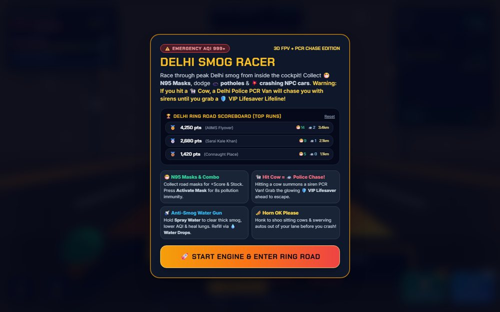

# Delhi Smog Racer: AQI 999+

A first-person 3D race through Delhi's winter smog, built with Three.js.

**[Open the live site](https://ajeet-iitk.github.io/DelhiSmog1/)**

## What it does

A first-person driving game where the joke is the visibility: the smog rolls in, the horizon disappears, and you keep the car on the road with whatever headlight the AQI leaves you. Rendering is Three.js over WebGL.

## Features

- 3D scene and lighting with Three.js
- First-person driving controls
- Smog density that eats your view distance
- Best run stored in `localStorage`
- Engine audio generated through `AudioContext`

## Run locally

Open `index.html`, or drive the hosted build:

<https://ajeet-iitk.github.io/DelhiSmog1/>

## Files

| File | Purpose |
| --- | --- |
| `index.html` | Landing page |
| `delhi_smog_racer_3d_fpv_game.html` | The game |

---

Part of [my collection of small projects](https://github.com/Ajeet-iitk).
